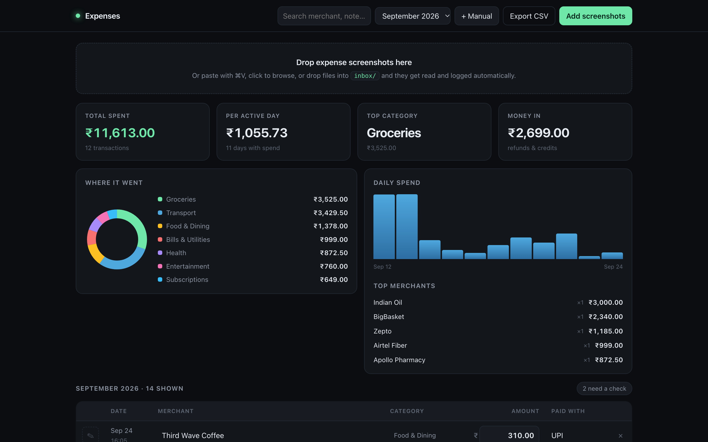
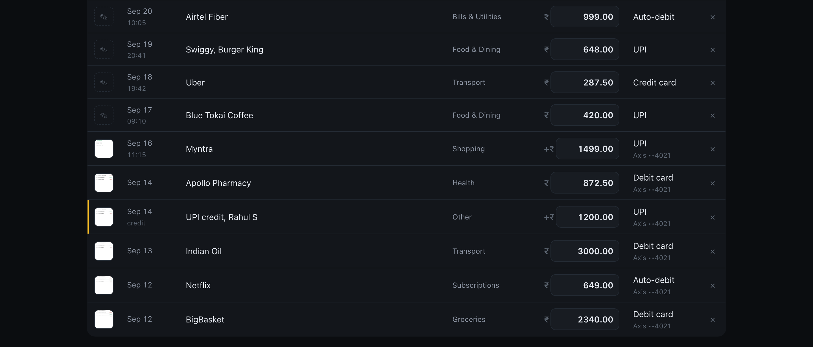

# Expense Tracker

**Drop a payment screenshot, get a logged expense. Runs entirely on your Mac, with no API key and no cloud account.**



## What it does

- **Reads any payment screenshot.** UPI apps, order confirmations, ride receipts, bank statement rows. One statement screenshot with five rows becomes five expenses.
- **Knows money in from money out.** Refunds, cashback and incoming transfers are logged as credits and never counted as spend. INR and USD are never added together.
- **Rejects what is not an expense.** A random chat screenshot gets turned away with a reason instead of a guessed amount.
- **Flags its own doubts.** Low-confidence rows get an amber bar and a "needs a check" filter. Every field is editable in place.
- **Four ways in.** Drag and drop, paste with ⌘V, drop files into a watched `inbox/` folder, or add a cash spend by hand.



## How it works

1. **macOS Vision OCR** (`ocr/ocr.swift`, compiled to `bin/vision-ocr`) pulls the text out of the image locally in about a second.
2. **Claude** looks at the actual image, with the OCR text as a hint, and returns structured JSON: merchant, amount, currency, date, time, category, payment method, account and reference. It runs through the `claude` CLI you are already signed into (`claude -p`), so there is no API key to manage.
3. **SQLite** stores everything via Node's built-in `node:sqlite`. Screenshots are deduplicated by file hash, so dropping the same one twice is a no-op.

Two screenshots are read at a time, roughly 10 to 20 seconds each. The page shows what is in flight and fills rows in as they land. Export to CSV from the header.

## Run it

Requires macOS, Node 22.5 or newer, Xcode command line tools (for `swiftc`) and [Claude Code](https://claude.com/claude-code) installed and logged in.

```bash
git clone <this-repo> ExpenseTracker && cd ExpenseTracker
swiftc -O -o bin/vision-ocr ocr/ocr.swift   # build the OCR helper once
./run.sh                                    # http://localhost:4477
```

Try it with the demo receipts in `samples/` (all values are fictional; `samples/make_samples.py` regenerates them).

Other options:

```bash
PORT=5000 ./run.sh                 # different port
HOST=0.0.0.0 ./run.sh              # reachable from your phone on the same wifi
./bin/add ~/Desktop/Screenshot*.png  # queue files from the shell
./bin/reset                        # wipe all expenses and stored screenshots (asks first)
```

Your data lives in `data/expenses.db` (plain SQLite), original screenshots in `shots/`. Both are gitignored.

## Honest caveats

- **macOS only.** OCR uses Apple's Vision framework and thumbnails use `sips`. If the OCR binary is missing, Claude still reads the image, just without the hint.
- **Each screenshot is one Claude Code call**, so it uses your Claude plan and needs a network connection for that step. The database and images never leave your machine.
- **No auth.** It binds to 127.0.0.1 by default. Only use `HOST=0.0.0.0` on a network you trust.
- Categories and prompts are tuned for Indian payment apps, though any currency works.

## Stack

Node.js (zero npm dependencies: `node:http`, `node:sqlite`) · vanilla HTML/CSS/JS · Swift + macOS Vision · Claude Code CLI
